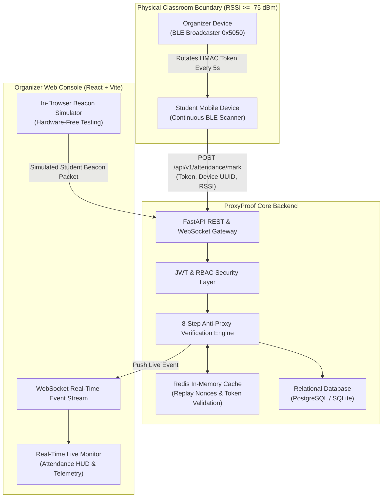
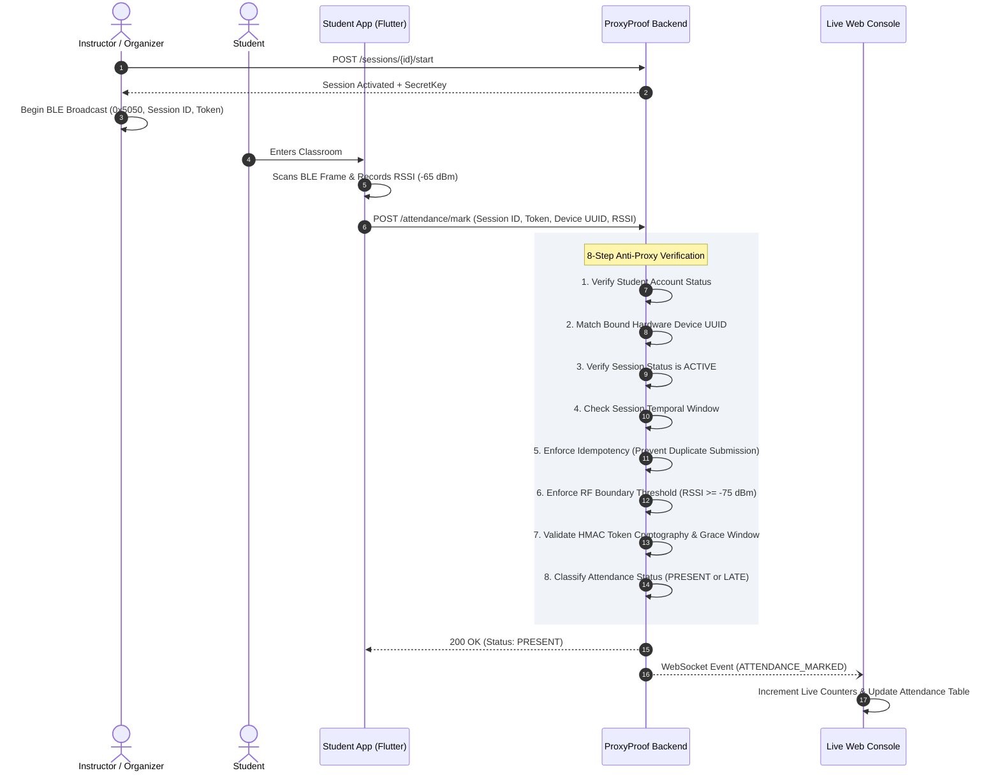
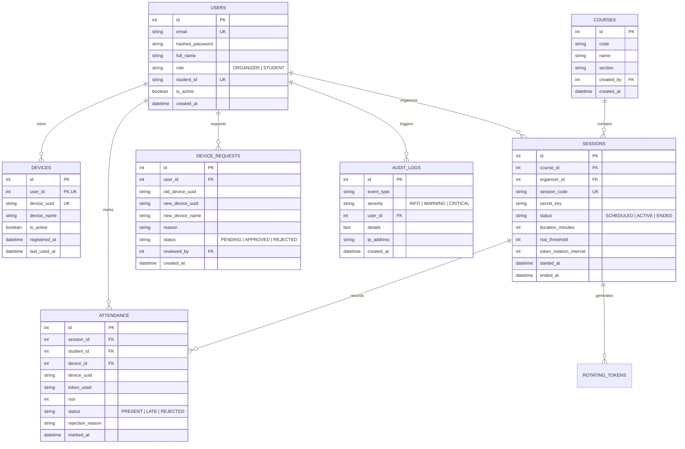

# ProxyProof

### Enterprise BLE Proximity Attendance Verification Platform

[](https://fastapi.tiangolo.com)
[](https://react.dev)
[](https://flutter.dev)
[](https://www.python.org)
[](https://www.typescriptlang.org)
[](https://www.docker.com)
[](LICENSE)

ProxyProof is an enterprise-grade attendance verification platform designed to eliminate academic proxy fraud. The system guarantees physical student presence inside lecture halls by combining 5-second rotating cryptographic tokens transmitted via Bluetooth Low Energy (BLE), one-to-one hardware device binding, and server-side radio-frequency (RF) signal attenuation validation.

---

## Table of Contents

- [Problem Statement and Security Model](#problem-statement-and-security-model)
- [System Architecture](#system-architecture)
- [Physical Layer BLE Protocol](#physical-layer-ble-protocol)
- [Anti-Proxy Verification Pipeline](#anti-proxy-verification-pipeline)
- [Interactive API Documentation](#interactive-api-documentation)
- [REST API Reference](#rest-api-reference)
- [Real-Time WebSocket Feeds](#real-time-websocket-feeds)
- [Database Schema and Entity-Relationship Model](#database-schema-and-entity-relationship-model)
- [Repository Structure](#repository-structure)
- [Local Development Setup](#local-development-setup)
- [Production Deployment with Docker](#production-deployment-with-docker)
- [Quality Assurance and Stress Testing](#quality-assurance-and-stress-testing)
- [License](#license)

---

## Problem Statement and Security Model

Traditional attendance methods fail against basic proxy tactics:

- **Static QR Codes**: Easily photographed, forwarded across messaging channels, and submitted from outside the lecture hall.
- **GPS-Based Check-Ins**: Easily circumvented via Android developer mock locations and GPS spoofing applications.
- **Manual Roll Calls**: Inefficient, consuming 10 to 15 minutes of lecture time while remaining vulnerable to impersonation.

ProxyProof enforces a multi-barrier defense model:

| Threat Vector | Adversary Technique | ProxyProof Defense |
| :--- | :--- | :--- |
| **Credential Sharing** | Absent student shares portal credentials with a present peer. | **Hardware Device Binding**: The peer's device UUID does not match the absent student's registered hardware UUID. The submission is blocked with `DEVICE_HARDWARE_MISMATCH`. |
| **Token Relaying** | Present student transmits attendance token to an absent peer via text/messaging. | **5-Second Ephemeral Rotation**: Tokens expire within 5 seconds. Relay across networks exceeds the validity window, resulting in `INVALID_OR_EXPIRED_ROTATING_TOKEN`. |
| **Boundary Sniffing** | Student attempts verification from outside the hall (corridor or parking area). | **RF Signal Thresholding**: Structural walls attenuate BLE signals to $\le -82\text{ dBm}$. Submissions below the configured cutoff ($\ge -75\text{ dBm}$) are rejected. |
| **Replay Attacks** | Adversary captures advertising frames and retransmits them later. | **Nonce and Window Tracking**: Tokens are valid only for discrete time intervals. Unique database constraints prevent duplicate submissions per session. |
| **Account Hopping** | Single phone used to sequentially check in multiple student accounts. | **Hardware Collision Defense**: A device UUID is bound to a single active user. Rapid successive submissions trigger security alerts in the organizer audit stream. |

---

## System Architecture



### Attendance Verification Lifecycle



---

## Physical Layer BLE Protocol

ProxyProof operates using **connectionless BLE Advertising** (`ADV_NONCONN_IND`). This avoids pairing latencies and connection limits, enabling hundreds of student devices to observe advertising packets concurrently.

### 26-Byte Binary Frame Layout

Legacy BLE advertising frames support up to 31 bytes. ProxyProof packs its cryptographic payload into **26 bytes**, fitting within a single packet without requiring a secondary `SCAN_RSP` frame:

```
+---------------+---------------+-------------------+------------------+------------------+-----------------------+
| AD Length(1B) | AD Type (1B)  | Company ID (2B)   | Session ID (4B)  | Window Index(4B) | HMAC Signature (16B)  |
|     0x1A      |     0xFF      |      0x5050       |    Big-Endian    |    Big-Endian    |       ASCII Hex       |
+---------------+---------------+-------------------+------------------+------------------+-----------------------+
```

| Field | Byte Offset | Length | Type | Description |
| :--- | :--- | :--- | :--- | :--- |
| **AD Length** | `0` | 1 byte | `uint8` | Total length of remaining frame (`0x1A` = 26 bytes). |
| **AD Type** | `1` | 1 byte | `uint8` | `0xFF` (Manufacturer Specific Data). |
| **Company Identifier** | `2..3` | 2 bytes | `uint16` | `0x5050` (Custom identifier for ProxyProof). |
| **Session ID** | `4..7` | 4 bytes | `uint32` | Big-endian unsigned integer identifying the active session. |
| **Window Index** | `8..11` | 4 bytes | `uint32` | Big-endian discrete time step index: $\lfloor \text{timestamp} / T \rfloor$. |
| **HMAC Signature** | `12..27` | 16 bytes | `char[16]` | Truncated hexadecimal HMAC-SHA256 digest. |

### Token Generation Formula

The organizer node calculates a new token at intervals of $T = 5$ seconds:

$$w = \left\lfloor \frac{t_{\text{current}}}{T} \right\rfloor$$

$$\text{Digest} = \text{HMAC-SHA256}\Big(K_{\text{session}}, \; \text{"PROXYPROOF:"} \,\|\, \text{SessionID} \,\|\, w\Big)$$

$$\text{Token} = \text{HexEncode}(\text{Digest})[0 : 16]$$

A grace tolerance $G = 1$ allows tokens generated at $w - 1$, $w$, or $w + 1$ to account for minor clock discrepancies and network transit time. Tokens older than 10 seconds are permanently rejected.

### RF Path Loss Propagation Model

Signal attenuation across distance follows the log-distance path loss formulation:

$$\text{RSSI}(d) = \text{RSSI}(d_0) - 10 \cdot n \cdot \log_{10}\left(\frac{d}{d_0}\right) - X_\sigma$$

- $d_0$: Reference distance ($1\text{ meter}$)
- $n$: Path loss exponent ($2.0$ for free space, $3.0\text{ to }4.0$ inside buildings with obstructions)
- $X_\sigma$: Zero-mean Gaussian random variable representing shadow fading

Reinforced concrete walls introduce an attenuation of $8\text{ to }15\text{ dB}$, dropping typical outdoor signal levels below $-82\text{ dBm}$. Setting the verification threshold at $-75\text{ dBm}$ ensures that attendance can only be validated from within the room.

---

## Anti-Proxy Verification Pipeline

Every incoming submission to `POST /api/v1/attendance/mark` is processed through an atomic 8-step pipeline:

```
[Incoming Attendance Request: session_id, token, device_uuid, rssi]
                           |
                           v
              +--------------------------+
              | 1. Account Status        | ----> Inactive / Invalid -> 401 Unauthorized
              +--------------------------+
                           | Valid
                           v
              +--------------------------+
              | 2. Device Hardware Match | ----> Mismatch -> REJECTED (Hardware Mismatch)
              +--------------------------+
                           | Valid
                           v
              +--------------------------+
              | 3. Session State         | ----> Not ACTIVE -> REJECTED (Session Closed)
              +--------------------------+
                           | Valid
                           v
              +--------------------------+
              | 4. Temporal Window       | ----> Out of Bounds -> REJECTED (Window Closed)
              +--------------------------+
                           | Valid
                           v
              +--------------------------+
              | 5. Duplicate Check       | ----> Record Exists -> REJECTED (Duplicate)
              +--------------------------+
                           | Valid
                           v
              +--------------------------+
              | 6. RF Proximity Check    | ----> RSSI < -75 dBm -> REJECTED (Weak Signal)
              +--------------------------+
                           | Valid
                           v
              +--------------------------+
              | 7. HMAC Token Crypto     | ----> Hash Mismatch / Stale -> REJECTED
              +--------------------------+
                           | Valid
                           v
              +--------------------------+
              | 8. Status Classification | ----> PRESENT (within 10m) / LATE (after 10m)
              +--------------------------+
                           |
                           v
           [Database Commit & WebSocket Broadcast]
```

---

## Interactive API Documentation

The backend provides OpenAPI / Swagger documentation and schema endpoints:

| Interface | Local Development (`:8005`) | Docker Environment (`:8000`) | Purpose |
| :--- | :--- | :--- | :--- |
| **Swagger UI** | [http://localhost:8005/docs](http://localhost:8005/docs) | [http://localhost:8000/docs](http://localhost:8000/docs) | Interactive testing environment with Bearer token authorization |
| **ReDoc** | [http://localhost:8005/redoc](http://localhost:8005/redoc) | [http://localhost:8000/redoc](http://localhost:8000/redoc) | Structured technical reference with complete schema definitions |
| **OpenAPI Specification** | [http://localhost:8005/openapi.json](http://localhost:8005/openapi.json) | [http://localhost:8000/openapi.json](http://localhost:8000/openapi.json) | Machine-readable OpenAPI 3.1.0 JSON schema |
| **Markdown Specification** | [docs/api_spec.md](docs/api_spec.md) | [docs/api_spec.md](docs/api_spec.md) | In-tree documentation for offline review |

---

## REST API Reference

All REST endpoints are versioned under `/api/v1` and require an `Authorization: Bearer <TOKEN>` header unless marked as Public.

### Authentication (`/api/v1/auth`)

| Method | Endpoint | Authorization | Description |
| :--- | :--- | :--- | :--- |
| `POST` | `/api/v1/auth/register` | Public | Register a new Organizer or Student account. |
| `POST` | `/api/v1/auth/login` | Public | Authenticate credentials and obtain an access token. |
| `GET` | `/api/v1/auth/me` | Authenticated | Retrieve identity profile, role, and bound device metadata. |

### Attendance Sessions (`/api/v1/sessions`)

| Method | Endpoint | Authorization | Description |
| :--- | :--- | :--- | :--- |
| `POST` | `/api/v1/sessions` | Organizer | Create a new attendance session with custom duration and RSSI limits. |
| `GET` | `/api/v1/sessions` | Authenticated | List all active and scheduled sessions. |
| `GET` | `/api/v1/sessions/{id}` | Authenticated | Retrieve session metadata and attendee metrics. |
| `POST` | `/api/v1/sessions/{id}/start` | Organizer | Activate session and start token rotation sequence. |
| `POST` | `/api/v1/sessions/{id}/end` | Organizer | Conclude session and lock attendance status. |
| `GET` | `/api/v1/sessions/{id}/token` | Authenticated | Fetch current rotating token, window index, and packed BLE advertisement. |

### Attendance Verification (`/api/v1/attendance`)

| Method | Endpoint | Authorization | Description |
| :--- | :--- | :--- | :--- |
| `POST` | `/api/v1/attendance/mark` | Student / Organizer | Submit beacon token, device UUID, and measured RSSI for validation. |
| `GET` | `/api/v1/attendance/history` | Authenticated | Retrieve personal attendance history (Student) or course history (Organizer). |
| `GET` | `/api/v1/attendance/live/{session_id}` | Organizer | Stream current session attendees, counts, and rejection details. |
| `POST` | `/api/v1/attendance/manual` | Organizer | Manually record or adjust student status with audit trail logging. |
| `DELETE` | `/api/v1/attendance/{attendance_id}` | Organizer | Revoke or remove an invalid attendance entry. |
| `GET` | `/api/v1/attendance/export` | Organizer | Export attendance records as CSV format. |

### Device Management (`/api/v1/devices`)

| Method | Endpoint | Authorization | Description |
| :--- | :--- | :--- | :--- |
| `POST` | `/api/v1/devices/register` | Student | Bind permanent physical device UUID to student account (1-to-1). |
| `GET` | `/api/v1/devices/my-device` | Student | Check current hardware registration status. |
| `POST` | `/api/v1/devices/change-request` | Student | Submit hardware migration request with justification. |
| `GET` | `/api/v1/devices/requests` | Organizer | List pending student hardware migration requests. |
| `PUT` | `/api/v1/devices/approve/{request_id}` | Organizer | Approve or reject a hardware device transfer. |

### Analytics and System Health (`/api/v1/analytics`, `/api/v1/health`)

| Method | Endpoint | Authorization | Description |
| :--- | :--- | :--- | :--- |
| `GET` | `/api/v1/analytics` | Organizer | Retrieve aggregate platform metrics (totals, attendance rate, active devices). |
| `GET` | `/api/v1/analytics/audit-logs` | Organizer | Query security audit trail with severity filtering (`INFO`, `WARNING`, `CRITICAL`). |
| `GET` | `/api/v1/health` | Public | Liveness check reporting database and cache status. |

---

## Real-Time WebSocket Feeds

| Channel | Endpoint | Description |
| :--- | :--- | :--- |
| **Session Stream** | `ws://localhost:8005/ws/sessions/{session_id}` | Broadcasts `ATTENDANCE_MARKED`, `ATTENDANCE_REMOVED`, `SESSION_STARTED`, and `SESSION_ENDED` events. |
| **Global Events** | `ws://localhost:8005/ws/events` | Broadcasts real-time security anomalies, spoof attempts, and device registration events to instructors. |

---

## Database Schema and Entity-Relationship Model



---

## Repository Structure

```
.
├── server/
│   ├── app/
│   │   ├── api/            # REST API routers (auth, sessions, attendance, devices, analytics)
│   │   ├── services/       # Core business logic (attendance verification, token crypto, anomaly detection)
│   │   ├── repositories/   # Database access abstraction layers
│   │   ├── models/         # SQLAlchemy ORM entity models
│   │   ├── security/       # JWT token handling, bcrypt password hashing, HMAC-SHA256 generators
│   │   ├── websocket/      # Real-time WebSocket connection pools
│   │   ├── middleware/     # HTTP request logging and rate limiting
│   │   ├── utils/          # Database seeding and date-time utilities
│   │   ├── config.py       # Pydantic configuration and environment variables
│   │   ├── database.py     # SQLAlchemy session setup and database engine
│   │   └── main.py         # Application entrypoint
│   ├── tests/              # Pytest integration and security test suite
│   ├── Dockerfile          # Python production container definition
│   └── requirements.txt    # Python package dependencies
├── client/
│   ├── src/
│   │   ├── pages/          # Management views (LiveSession, History, DeviceApproval, AuditLog, Analytics)
│   │   ├── components/     # UI components (Beacon Simulator, Radar HUD, StatsCard, Modals)
│   │   ├── services/       # Axios REST client and WebSocket subscribers
│   │   ├── hooks/          # Custom React hooks (useAuth)
│   │   ├── types/          # TypeScript interface definitions
│   │   ├── App.tsx         # Application router and navigation layout
│   │   └── main.tsx        # React 19 entrypoint with TanStack Query Provider
│   ├── nginx.conf          # Nginx production reverse proxy configuration
│   ├── Dockerfile          # Multi-stage production build container
│   └── package.json        # Frontend dependencies and build scripts
├── mobile/
│   ├── lib/
│   │   ├── screens/        # Flutter views (StudentHome, SessionScanner, DeviceRegistration, Login)
│   │   ├── services/       # BLE scanner, BLE advertiser, and device identifier services
│   │   ├── providers/      # Riverpod reactive state management
│   │   ├── widgets/        # Radar display, status badges, attendance cards
│   │   ├── models/         # Binary BLE packet decoders, user, session, attendance models
│   │   └── main.dart       # Application entrypoint
│   ├── pubspec.yaml        # Flutter dependencies
│   └── README.md           # Mobile app documentation
├── scripts/
│   ├── demo_walkthrough.py # Automated 5-scenario security verification test harness
│   ├── load_test.py        # High-concurrency stress benchmark script
│   └── keep_adb_reverse.ps1# Persistent ADB reverse tunneling daemon for physical hardware
├── docker/
│   ├── docker-compose.yml  # Multi-container orchestration (Backend, Frontend, Postgres, Redis)
│   └── .env.example        # Environment variable template
├── docs/
│   ├── ble_protocol.md     # BLE binary frame specifications and RF propagation models
│   ├── security_model.md   # Threat analysis and verification pipeline breakdown
│   └── api_spec.md         # Comprehensive REST API reference
└── README.md               # Repository documentation
```

---

## Local Development Setup

### Prerequisites

- Python 3.12 or 3.13
- Node.js 20 or higher and npm
- Flutter 3.x (for mobile application compilation)
- Android SDK / ADB (for physical mobile device testing)

### 1. Backend Server Setup

```bash
cd server
python -m venv venv
# Windows:
.\venv\Scripts\activate
# Linux/macOS:
source venv/bin/activate

pip install -r requirements.txt
python -m uvicorn app.main:app --host 0.0.0.0 --port 8005 --reload
```

The database automatically initializes SQLite `proxyproof.db` and loads default test accounts:

- **Organizer**: `prof.smith@university.edu` / `Admin@1234`
- **Student 1**: `alice@university.edu` / `Student@1234`
- **Student 2**: `bob@university.edu` / `Student@1234`

### 2. Frontend Management Console Setup

```bash
cd client
npm install
npm run dev
```

Navigate to `http://localhost:5173`. The management console includes an **in-browser BLE Beacon Simulator**, allowing full verification of token rotation, proximity calculation, and attendance workflows without requiring physical hardware.

### 3. Mobile Client and Hardware Setup

```bash
cd mobile
flutter pub get
flutter run
```

To connect a physical Android smartphone over USB debugging with reverse tunneling:

```powershell
# Forward local backend port 8005 to connected device
adb reverse tcp:8005 tcp:8005
```

The mobile client connects to `http://127.0.0.1:8005/api/v1` through the USB bridge, extracting the hardware UUID to bind the account on registration.

---

## Production Deployment with Docker

To deploy the production-ready multi-container stack (FastAPI Backend, PostgreSQL 16, Redis 7, and Nginx React Client):

```bash
cd docker
docker compose up --build -d
```

- **Web Dashboard**: `http://localhost:3000`
- **API Documentation**: `http://localhost:8000/docs`
- **WebSocket Gateway**: `ws://localhost:8000/ws/sessions/{id}`

---

## Quality Assurance and Stress Testing

### 1. Integration Test Suite

The test suite validates cryptographic determinism, token lifetime expiry, binary packing, RSSI boundaries, and device mismatch defense:

```bash
python -m pytest server/tests -v
```

All 7 integration test suites pass with full assertions across business logic and repository layers.

### 2. Automated Attack Scenario Walkthrough

The repository includes an end-to-end simulation executing all 5 threat scenarios against the active backend:

```bash
python scripts/demo_walkthrough.py
```

Scenarios evaluated:
1. Valid attendance submission (Verification successful, status marked `PRESENT`).
2. Duplicate attendance attempt within the same session (Blocked with status `REJECTED`).
3. Weak RSSI signal representing outdoor / hallway proxy (Blocked with `PROXIMITY_RSSI_TOO_WEAK`).
4. Stale / expired HMAC token (Blocked with `INVALID_OR_EXPIRED_ROTATING_TOKEN`).
5. Hardware device mismatch representing credential sharing (Blocked with `DEVICE_HARDWARE_MISMATCH`).

### 3. High-Concurrency Stress Benchmark

Evaluate throughput and latency under concurrent student arrivals using the load test harness:

```bash
# 100 students with 50 concurrent connections
python scripts/load_test.py --students 100 --concurrency 50

# 500 students with 100 concurrent connections
python scripts/load_test.py --students 500 --concurrency 100

# 1000 students with 200 concurrent connections
python scripts/load_test.py --students 1000 --concurrency 200
```

Performance Metrics Captured:
- Sustained request throughput (requests per second)
- Latency percentiles (min, mean, p50, p95, p99, max)
- Rejection precision under simulated load

---

## License

This project is licensed under the MIT License. See [LICENSE](LICENSE) for details.
