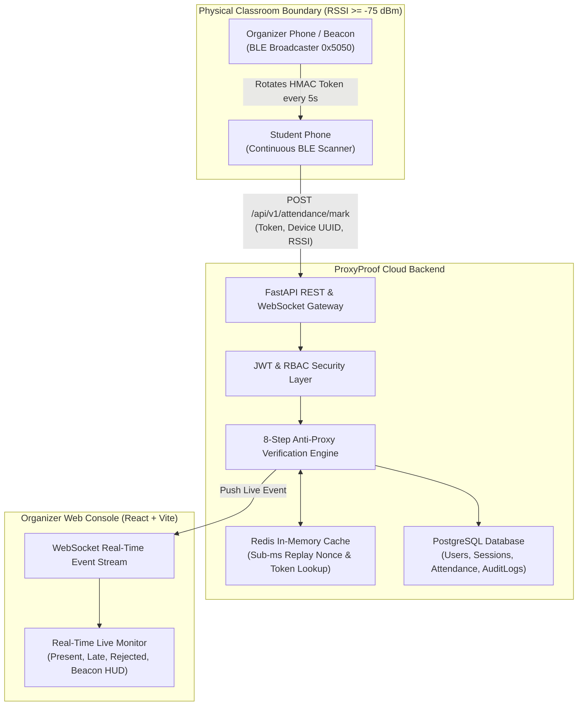
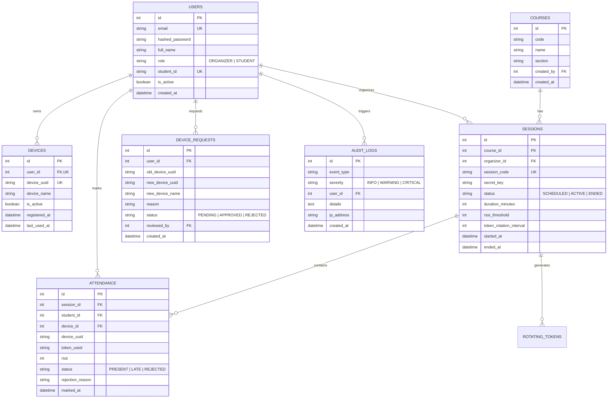

# ProxyProof – BLE-Based Smart Attendance System

> A secure, enterprise-grade Bluetooth Low Energy (BLE) attendance verification platform designed to guarantee physical student presence inside lecture halls through rotating cryptographic tokens, 1-to-1 hardware device binding, and server-side RF proximity validation.

---

## Architecture Overview



---

## BLE Workflow & Attendance Lifecycle

```mermaid
sequenceDiagram
    autonumber
    actor Organizer as Organizer / Instructor
    actor Student as Student
    participant Mobile as Student App (Flutter)
    participant Server as ProxyProof Backend
    participant Dashboard as Live Web Console

    Organizer->>Server: POST /sessions/{id}/start
    Server-->>Organizer: Session Activated + SecretKey
    Organizer->>Organizer: Start BLE Advertising (0x5050, SessionID, Token)
    Note over Organizer: Token rotates every 5 seconds (HMAC-SHA256)

    Student->>Mobile: Enters classroom with app open
    Mobile->>Mobile: Scans BLE advertisement & measures RSSI (-62 dBm)
    Mobile->>Server: POST /attendance/mark (SessionID, Token, DeviceUUID, RSSI)
    
    rect rgb(20, 24, 20)
        Note over Server: 8-Step Anti-Proxy Verification
        Server->>Server: 1. Validate bound hardware Device UUID
        Server->>Server: 2. Verify Session is ACTIVE & within time window
        Server->>Server: 3. Verify RSSI >= -75 dBm threshold
        Server->>Server: 4. Verify HMAC token crypto & grace window
        Server->>Server: 5. Prevent duplicate submission
    end

    Server-->>Mobile: 200 OK (Status: PRESENT)
    Server--)Dashboard: WebSocket Event (ATTENDANCE_MARKED)
    Dashboard->>Dashboard: Live Table Updates Instantly
```



---

## Entity-Relationship (ER) Diagram



---

## Folder Structure

```
d:\vinno_app\
├── server/
│   ├── app/
│   │   ├── api/            # REST Endpoints (auth, sessions, attendance, devices, analytics)
│   │   ├── services/       # Business Logic (attendance_service, token_service, anomaly_service)
│   │   ├── repositories/   # Base and entity database repositories
│   │   ├── models/         # SQLAlchemy models (User, Device, Session, Attendance, AuditLog)
│   │   ├── security/       # JWT tokens, bcrypt hashing, HMAC rotating crypto
│   │   ├── websocket/      # Real-time WebSocket connection manager
│   │   ├── middleware/     # Access logging and rate limiter
│   │   ├── utils/          # Seed data and datetime normalizers
│   │   ├── config.py       # Pydantic environment configuration
│   │   ├── database.py     # SQLAlchemy engine and session
│   │   └── main.py         # FastAPI application entrypoint
│   ├── tests/              # Pytest test suite (7 comprehensive integration tests)
│   ├── Dockerfile
│   └── requirements.txt
├── client/
│   ├── src/
│   │   ├── pages/          # LiveSession, Sessions, AttendanceHistory, DeviceApproval, AuditLog, Analytics, Login
│   │   ├── components/     # TokenBeaconSimulator, Navbar, StatsCard, Modal, Badge
│   │   ├── services/       # API client and WebSocket client
│   │   ├── hooks/          # useAuth hook
│   │   ├── types/          # TypeScript interface definitions
│   │   ├── App.tsx         # Tab router and global layout
│   │   └── main.tsx        # React entrypoint with TanStack QueryClient
│   ├── nginx.conf
│   ├── Dockerfile
│   └── package.json
├── mobile/
│   ├── lib/
│   │   ├── screens/        # StudentHomeScreen, OrganizerSessionScreen, DeviceRegistration, Login, Register
│   │   ├── services/       # ble_scanner_service, ble_advertiser_service, device_info_service
│   │   ├── providers/      # Riverpod state notifiers
│   │   ├── widgets/        # ble_radar, status_badge, attendance_card, enterprise_card
│   │   ├── models/         # ble_packet (26-byte binary decoder), user, session, attendance
│   │   └── main.dart
│   ├── pubspec.yaml
│   └── README.md
├── scripts/
│   ├── demo_walkthrough.py # Instant 5-scenario anti-proxy test harness
│   └── load_test.py        # High-concurrency stress benchmark (100, 500, 1000 students)
├── docker/
│   ├── docker-compose.yml  # Turnkey multi-container stack (Server, Client, Postgres, Redis)
│   └── .env.example
├── docs/
│   ├── ble_protocol.md     # BLE 26-byte frame specification and RF path loss model
│   ├── security_model.md   # Threat model and 8-point anti-proxy pipeline
│   └── api_spec.md         # Complete REST API reference
├── ARCHITECTURE.html       # Standalone interactive developer & interview guide
└── README.md
```

---

## Quickstart & Local Setup

### 1. Run Server Standalone (Python 3.13)
```bash
cd server
python -m pip install -r requirements.txt
python -m uvicorn app.main:app --host 0.0.0.0 --port 8005 --reload
```
The database will automatically initialize SQLite `proxyproof.db` and seed demo users:
- **Organizer**: `prof.smith@university.edu` / `Admin@1234`
- **Student 1**: `alice@university.edu` / `Student@1234`
- **Student 2**: `bob@university.edu` / `Student@1234`

### 2. Run Client Web Dashboard (React + Vite + TypeScript)
```bash
cd client
npm install
npm run dev
```
Open [http://localhost:5173](http://localhost:5173). The dashboard includes an **interactive in-browser BLE Beacon Simulator** to test token rotation and student attendance directly from the UI without physical phones.

### 3. Run Server Integration Test Suite
```bash
python -m pytest server/tests -v
```
*(All 7 tests pass: registration, password hashing, HMAC determinism, grace window expiry, binary packing/unpacking, device mismatch blocking, and weak RSSI rejection).*
*(All 7 tests pass: registration, password hashing, HMAC determinism, grace window expiry, binary packing/unpacking, device mismatch blocking, and weak RSSI rejection).*

---

## Turnkey Docker Deployment

To launch the full production stack (FastAPI Backend, PostgreSQL 16, Redis 7, and Nginx React Dashboard):

```bash
cd docker
docker-compose up --build
```
- **Web Dashboard**: [http://localhost:3000](http://localhost:3000)
- **API Documentation**: [http://localhost:8000/docs](http://localhost:8000/docs)
- **WebSocket Feeds**: `ws://localhost:8000/ws/sessions/{id}`

---

## Load & Concurrency Stress Testing

Simulate high-volume student arrivals (100, 500, or 1000 students) sending concurrent attendance requests:

```bash
# Test 100 students with 50 concurrent connections
python scripts/load_test.py --students 100 --concurrency 50

# Test 500 students with 100 concurrent connections
python scripts/load_test.py --students 500 --concurrency 100

# Test 1000 students with 200 concurrent connections
python scripts/load_test.py --students 1000 --concurrency 200
```
Measures:
- Throughput (requests/second)
- Latency distribution: min, mean, p50, p95, p99, max
- Rejection accuracy (weak RSSI outside classroom vs valid indoor attendees)

---

## Anti-Proxy Security Guarantees

1. **One Student = One Device**: Hardware UUID (`device_uuid`) permanently bound to student account. Attendance cannot be submitted from another student's phone.
2. **5-Second Rotating Tokens**: Cryptographic HMAC-SHA256 signatures expire in 5 seconds, neutralizing screenshot and messaging app relays.
3. **Physical RF Boundary ($-75\text{ dBm}$ Cutoff)**: Wall and door attenuation ensures students outside the lecture hall are rejected.
4. **Duplicate Prevention**: Database unique constraints enforce exactly one attendance record per session per student.
5. **Real-time Anomaly Detection**: Floods, replay attempts, and hardware mismatches are flagged with `CRITICAL` audit logs streamed to the organizer dashboard.

---

## Developer Architecture Guide

Open `ARCHITECTURE.html` in any browser to explore the interactive visual guide, folder breakdown, and comprehensive technical interview Q&A.
